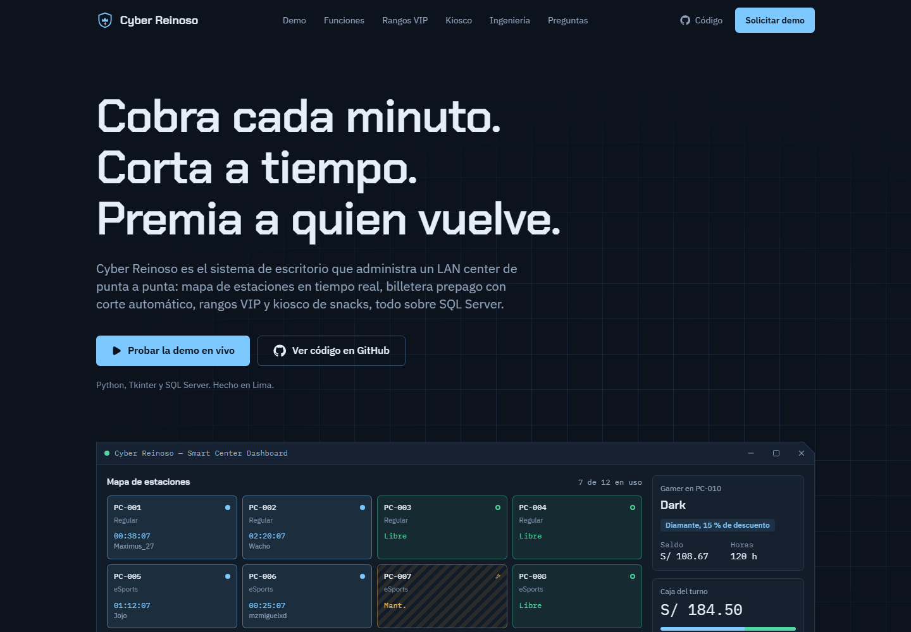
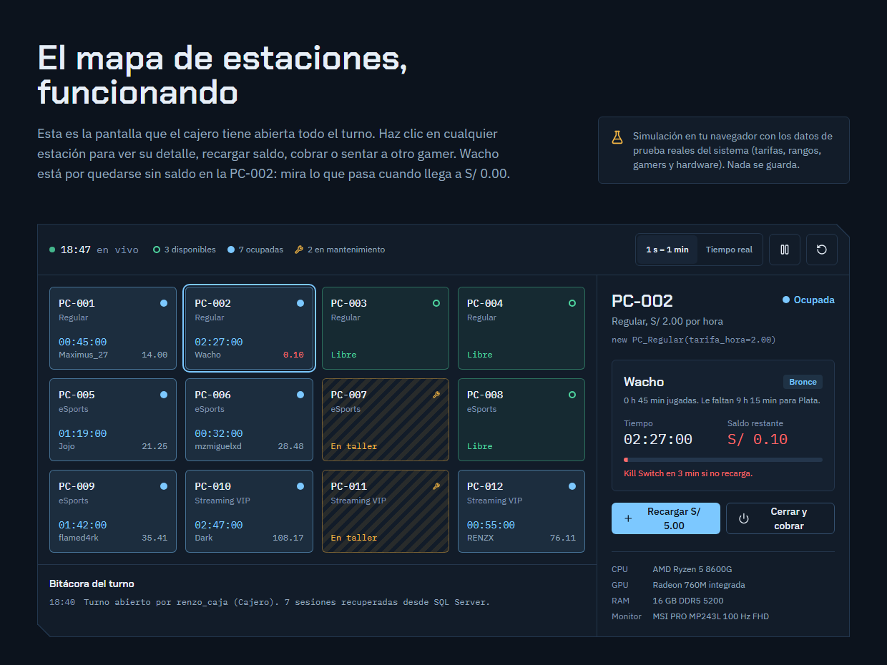

# Cyber Reinoso: cobra cada minuto, corta a tiempo, premia a quien vuelve

[English](README.md) · **Español**

**Demo en vivo:** [cyber-reinoso-web.vercel.app](https://cyber-reinoso-web.vercel.app/)

Página de producto de **Cyber Reinoso**, un sistema de escritorio (Python + Tkinter + SQL Server) para administrar LAN centers y arenas de eSports. La página lo presenta como un producto comercial e incluye una **demo interactiva del mapa de estaciones**, hecha en React, que reproduce en el navegador las reglas de negocio reales del sistema.



> Repositorio del sistema: [github.com/Itsfavi0/Cyber-Reinoso](https://github.com/Itsfavi0/Cyber-Reinoso)

## Qué es

Cyber Reinoso resuelve los cuatro puntos donde un LAN center pierde dinero: el tiempo que no se cobra, los clientes que se pasan de lo pagado, el kiosco que no cuadra con la caja y los clientes frecuentes que no tienen motivo para volver. Esta página explica eso en 30 segundos a un dueño de local, y muestra a un reclutador cómo está construido por dentro.

Todas las cifras de la página salen del código real del sistema: tarifas por categoría (`CategoriasEstacion`), umbrales y descuentos VIP (`modelos.py`), hardware de las 12 estaciones y gamers de prueba (`estructura_db.sql`) y consultas SQL (`conexion.py`).

## Secciones

1. **Hero**: propuesta de valor y una vista previa del panel con los cronómetros en marcha.
2. **Problema / solución**: cinco situaciones de un local, antes y después del sistema.
3. **Demo interactiva** (pieza principal): mapa de 12 estaciones con estados, cronómetros, saldo que baja y **Kill Switch** que corta solo la sesión al llegar a S/ 0.00. Al hacer clic en una estación se ve su detalle, el gamer y su rango, y se puede recargar, cobrar, sentar a otro gamer o enviarla a mantenimiento.
4. **Funciones**: un bento con jerarquía (billetera y Kill Switch como pieza grande, tarifas, roles, recuperación ante cortes de luz, borrado lógico y reportes PDF).
5. **Rangos VIP**: tabla de rangos y una calculadora de ahorro.
6. **Kiosco POS**: punto de venta interactivo con boleta cabecera-detalle, stock en vivo, saldo insuficiente y un interruptor para simular un error de SQL Server y ver el ROLLBACK.
7. **Ingeniería**: diagrama SVG de las capas (UI → Mediator → Negocio / DAO → SQL Server), decisiones de diseño y tres consultas SQL reales con resaltado propio.
8. **Stack**, **preguntas frecuentes** y **CTA** con formulario de demo que valida y confirma en la página.



## Stack

- **React 19** + **Vite 8**
- **Tailwind CSS 4** (tokens en `@theme`, sin archivo de configuración)
- **lucide-react** para íconos
- **@fontsource** para fuentes autohospedadas (Chakra Petch, IBM Plex Sans, IBM Plex Mono)
- **oxlint** como linter (viene con el scaffold actual de Vite)

Sin librerías de animación ni de estado: el movimiento es CSS y la simulación es un `useReducer`.

## Cómo ejecutarlo

Requiere Node 20.19 o superior (lo pide Vite 8).

```bash
npm install
npm run dev       # http://localhost:5173
npm run build     # build de producción en dist/
npm run preview   # sirve el build en http://localhost:5173
npm run lint
```

## Estructura

```text
src/
├── App.jsx                      # orden de las secciones
├── index.css                    # tokens de diseño, base y animaciones
├── data/
│   ├── catalog.js               # estaciones, categorías, gamers y productos (del SQL real)
│   ├── sqlSnippets.js           # consultas copiadas de conexion.py
│   └── site.js                  # enlaces y navegación
├── lib/
│   ├── billing.js               # reglas portadas de modelos.py y main.py (rangos, tarifas, Kill Switch)
│   ├── highlightSql.js          # tokenizador mínimo para resaltar SQL sin innerHTML
│   └── validateDemoRequest.js   # validación del formulario
├── hooks/
│   ├── useStationSimulation.js  # motor de la demo (reducer + reloj de 1 s)
│   ├── useInView.js             # pausa la simulación fuera de pantalla
│   └── usePrefersReducedMotion.js
└── components/
    ├── layout/                  # Nav (con menú móvil) y Footer
    ├── sections/                # una sección por archivo
    ├── demo/                    # piezas del mapa: tile, detalle, bitácora, barra de controles
    ├── engineering/             # diagrama de arquitectura y pestañas de SQL
    ├── form/                    # formulario de demo y campo accesible
    └── ui/                      # logo, estados, ícono de GitHub
```

## Decisiones de diseño

- **Dirección de arte**: "consola de operaciones" sobria, más cerca de Linear o Vercel que de un estilo gamer con luces RGB. Fondo pizarra azul noche y **un solo acento frío** (`#7CC8FF`) que hereda el azul del logo real.
- **Colores de estado coherentes en toda la página**: Disponible = menta, Ocupada = acento hielo, Mantenimiento = ámbar con rayado diagonal, corte = rojo señal. Ningún estado depende solo del color: cada uno tiene su forma (anillo, punto lleno, llave) y texto.
- **Tipografía**: Chakra Petch (display angular, de interfaz de juego competitivo), IBM Plex Sans para el cuerpo e IBM Plex Mono para cifras, cronómetros y SQL.
- **Elemento firma**: el marco de panel con esquina chaflanada (`clip-path`), reservado solo para las piezas "de consola" (vista previa, demo, calculadora, kiosco y formulario). El resto de la página es tranquilo y alineado a la izquierda.
- **Descartes**: la paleta violeta + rosa neón que propuso la herramienta de diseño (es el cliché que el brief prohíbe) y el verde fósforo sobre negro (demasiado visto).
- **Movimiento**: una sola coreografía de entrada en el hero; el resto del movimiento responde a acciones del usuario (presionar botones, el destello del corte, el menú móvil). Solo `transform` y `opacity`, con curvas ease-out propias.
- **Marcas reales**: el inventario de prueba del sistema usa marcas comerciales; la página muestra nombres genéricos con los mismos precios y stock, y no usa las fotos de productos ni de PCs del repositorio porque muestran logos de terceros.

## Decisiones técnicas

- **Lógica de negocio separada de la UI**: `lib/billing.js` contiene las mismas reglas que `modelos.py` (rangos por minutos, descuento por rango, tarifa por minuto redondeada) y el criterio del Kill Switch de `actualizar_cronometros()`: si el costo del próximo minuto, con descuento, supera el saldo, se corta y se cobra lo que quedaba.
- **Simulación con `useReducer`**: todas las transiciones (tick, iniciar, cerrar, recargar, mantenimiento) son funciones puras fáciles de probar. El reloj solo corre mientras la demo está en pantalla (`IntersectionObserver`).
- **Resaltado de SQL propio**: un tokenizador de 20 líneas que devuelve fragmentos `{ text, kind }` y se pintan como `<span>`. Evita una librería pesada y el uso de `innerHTML`.
- **Fuentes autohospedadas**, solo el subconjunto latin y los pesos usados, con `font-display: swap`.
- **Estilos base fuera de `@layer`**: el fondo, el color y la tipografía del `body` están fuera de las capas de Tailwind. Los estilos sin capa siempre le ganan a los que están en una, así que si quien aloja la página inyecta su propio `body { background: #fff }` (pasa al incrustarla en visores o previsualizaciones), el tema oscuro se mantiene en lugar de dejar texto claro sobre fondo blanco.

## Accesibilidad

- HTML semántico, un solo `h1`, encabezados en orden y enlace "Saltar al contenido".
- Navegación completa con teclado, foco visible, menú móvil con `aria-expanded` y cierre con Escape, pestañas de SQL con el patrón ARIA (flechas, Inicio y Fin).
- Contraste AA verificado para todos los pares de texto (el texto más tenue llega a 5:1).
- Los cortes automáticos se anuncian con una región `aria-live`; la simulación se puede pausar.
- Formulario con etiquetas visibles, errores junto al campo enlazados con `aria-describedby`, foco en el primer error y confirmación enfocada.
- `prefers-reduced-motion`: sin desplazamientos (solo fundidos suaves), la vista previa del hero se detiene y el desplazamiento automático no se anima.
- Objetivos táctiles de 44 px o más en pantallas táctiles.

## Rendimiento

Lighthouse sobre el build de producción (`npm run preview`):

| | Rendimiento | Accesibilidad | Buenas prácticas | SEO |
| --- | --- | --- | --- | --- |
| Móvil | 94 | 100 | 100 | 100 |
| Escritorio | 100 | 100 | 100 | 100 |

JavaScript de unos 95 kB comprimido, CSS de 8 kB comprimido, sin imágenes de mapa de bits en la página (todo es SVG o CSS).

## Créditos

- Contenido, reglas de negocio y datos de prueba: sistema Cyber Reinoso, de Favio Brañez.
- Íconos: [Lucide](https://lucide.dev) (licencia ISC). Ícono de GitHub: marca de GitHub, usado solo para enlazar al repositorio.
- Fuentes: Chakra Petch (Cadson Demak) e IBM Plex (IBM), ambas con licencia SIL Open Font.
- No se usan fotografías.

## Ideas futuras

- Pruebas unitarias de `lib/billing.js` y del reducer de la simulación (Vitest).
- Modo "día completo" en la demo, con reporte de caja al cierre del turno.
- Versión en inglés.
- Capturas reales de la aplicación de escritorio junto a la recreación.

---

Diseñado y desarrollado por [Favio Brañez](https://github.com/Itsfavi0), estudiante de Ingeniería de Sistemas en la UNAC (Lima, Perú).
